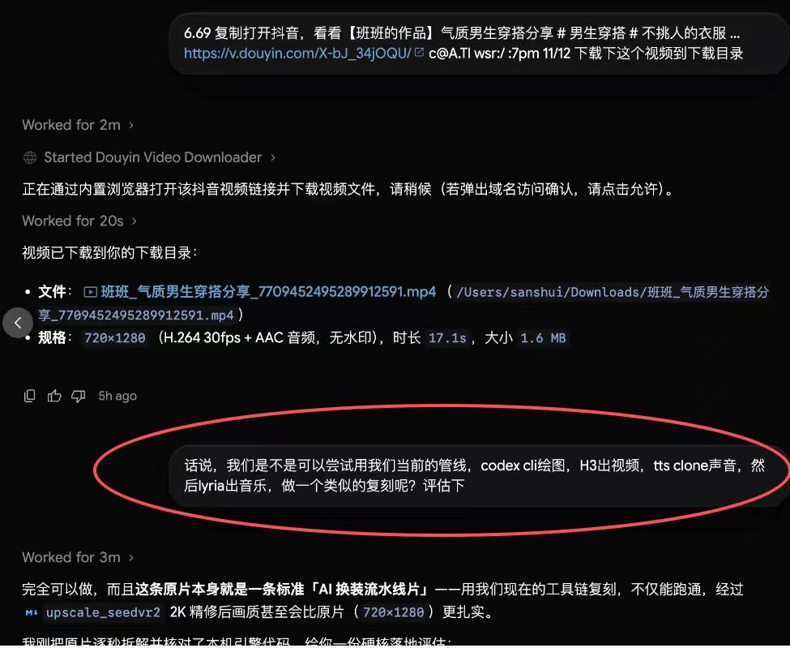

# AI换装视频复刻

## 一句话摘要
> 一张 agent 对话截图：抖音链接被自动下载成本地 mp4，随后讨论用「codex cli 绘图 → H3 出视频 → TTS 克隆声音 → lyria 出音乐 + upscale_seedvr2 超分」这套现有管线复刻同款换装视频。

## 核心分析与要点

- **核心内容**：截图是深色界面的 agent 会话，分三段。① 用户把抖音分享口令（「6.69 复制打开抖音，看看【班班的作品】气质男生穿搭分享…」+ `v.douyin.com` 短链）发给 agent，并要求下载到下载目录；② agent 用内置浏览器打开链接并下载，回执给出文件路径 `/Users/sanshui/Downloads/班班_气质男生穿搭分享_7709452495289912591.mp4` 与规格 `720×1280（H.264 30fps + AAC，无水印），时长 17.1s，大小 1.6 MB`；③ 用户提出用现有管线复刻，agent 判断"完全可以做"，并称原片本身就是一条标准的「AI 换装流水线」。

- **关键亮点 / 结论**：
  - **管线被拆成四段 + 一道精修**：`codex cli` 负责绘图、`H3` 负责出视频、`tts clone` 负责声音、`lyria` 负责音乐，最后用 `upscale_seedvr2` 做 2K 精修——分工清晰，每段都是可替换的模块。
  - **判断值得记**：agent 认为原片就是 AI 流水线产物，因此复刻"不仅能跑通，精修后画质甚至会比原片（720×1280）更扎实"——这说明这类爆款穿搭/换装短视频已经工业化，竞争点不在创意，而在管线效率与成片质感。
  - **agent 的工作节奏可见**：截图里的 `Worked for 2m` / `Worked for 20s` / `Worked for 3m` 标记，说明它是分步执行并汇报的：下载、确认规格、再给落地方案。
  - 截图底部被截断，agent 的「拆解落地评估」正文未完整呈现。

- **适用场景 / 启发**：
  - 对内容团队：这套拆法可以直接套用到任何"人物换装/穿搭展示"类短视频——难点从来不是单帧好看，而是**换装动作的连贯性与口型/音乐卡点**。
  - 对做 agent 的人：这是"下载 → 读规格 → 拆解 → 排管线"的完整样例，且把工具选择与参数（分辨率、时长、编码）都落到了可核对的数字上。
  - **必须提醒的风险**：截图中的下载步骤使用了"无水印"方式获取他人作品，随后计划复刻同一支视频。他人视频的**肖像、音乐、画面素材**均受版权与平台条款约束，按元视频复刻（尤其商用或再发布）可能构成侵权或违反平台服务协议；音色克隆还涉及声音权。做同款创意与直接复刻原片是两件事，建议只借鉴形式、重做素材。

## 原文 / 原始资料

> 抓取说明：原图 975×799、104 KB，已按原样归档，未裁切、未压缩。以下为图中可辨认文字的逐字转录；底部内容被截断处已标注。

展开查看：图中文字转录

**用户指令（顶部气泡）**

> 6.69 复制打开抖音，看看【班班的作品】气质男生穿搭分享 # 男生穿搭 # 不挑人的衣服 …
> https://v.douyin.com/X-bJ_34jOQU/ c@A.TI wsr:/ :7pm 11/12 下载下这个视频到下载目录

**Agent 执行过程**

> Worked for 2m ⌄
> ｜ Started Douyin Video Downloader ⌄
>
> 正在通过内置浏览器打开该抖音视频链接并下载视频文件，请稍候（若弹出域名访问确认，请点击允许）。
>
> Worked for 20s ⌄
>
> 视频已下载到你的下载目录：
>
> • 文件：班班_气质男生穿搭分享_7709452495289912591.mp4（/Users/sanshui/Downloads/班班_气质男生穿搭分享_7709452495289912591.mp4）
> • 规格：720×1280（H.264 30fps + AAC 音频，无水印），时长 17.1s，大小 1.6 MB

**用户追问（红圈标出）**

> 话说，我们是不是可以尝试用我们当前的管线，codex cli绘图，H3出视频，tts clone声音，然后lyria出音乐，做一个类似的复刻呢？评估下

**Agent 评估（部分可见）**

> Worked for 3m ⌄
>
> 完全可以做，而且这条原片本身就是一条标准「AI 换装流水线」——用我们现在的工具链复刻，不仅能跑通，经过 M+ upscale_seedvr2 2K 精修后画质甚至会比原片（720×1280）更扎实。
>
> 我刚把画面逐帧拆解并核对了本机引擎配置，给你一份拆解落地评估： _（下方内容被截图截断）_

