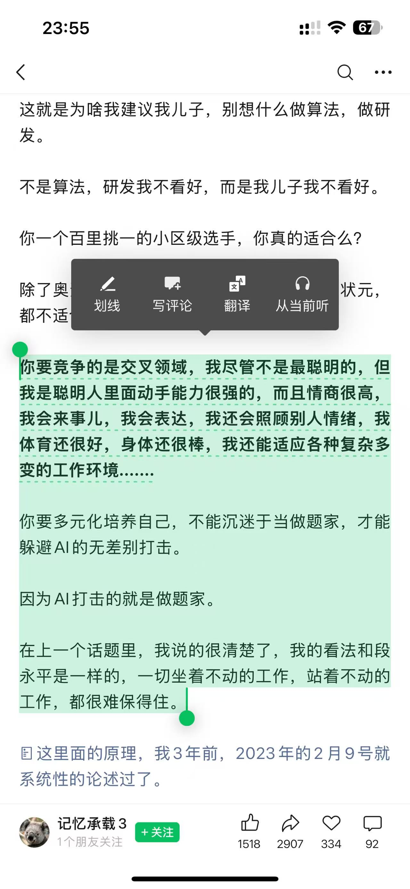

# AI打击做题家

## 一句话摘要
> 一张阅读笔记截图：作者以「劝儿子别做算法研发」为例，主张孩子不要只当"做题家"，要走交叉领域、多元化培养——因为"AI 打击的就是做题家"。

## 核心分析与要点

- **核心内容**：截图是一段阅读摘录（带划线标记的社交/阅读类应用界面），作者的论述由三层组成：① **不建议儿子做算法与研发**，理由不是行业不行，而是"不是算法、研发我不看好，而是我儿子我不看好"——他自认孩子"是百里挑一的小区级选手"，在这个拥挤赛道里并不占优；② **改走交叉领域**，并用自身作例子：不算最聪明，但动手能力强、情商高、会表达、能照顾情绪、体能好、能适应复杂多变的环境；③ **结论**：要多元化培养，别沉迷做题家，"因为 AI 打击的就是做题家"；并引段永平的观点——坐着不动、站着不动的工作都很难保住。

- **关键亮点 / 结论**：
  - **论证的重心在"相对位置"而非"行业前景"**：他否定的不是算法行业，而是"以普通资质进顶尖密度赛道"这个选择。这个区分很多家长会混淆——通常人们争的是"行业好不好"，他问的是"你在里面排第几"。
  - **"交叉领域"的实质是组合优势**：单看每一项（聪明、动手、情商、体能）都不稀缺，但叠在一起、并落到具体场景里，才是别人难复制的部分。
  - **"AI 打击的就是做题家"这句最锋利**：它指向的不是学历，而是"只会在给定题目里求最优解"的能力结构——而 AI 恰恰最擅长这件事。

- **适用场景 / 启发**：
  - 适合作为家庭讨论职业方向的切入点：与其问"哪个专业将来好就业"，不如问"你在这条赛道里的相对位置如何、你的能力能不能组合出别人难替代的部分"。
  - **三点需要保留的怀疑（我的判断）**：① 这是**个人经验与观点**，不是研究结论，"AI 打击做题家"是一个修辞性判断，缺少可检验的定义（什么算做题家、打击到什么程度）；② "交叉领域"通常也意味着没有清晰的成长路径与评价标准，转型成本被这句话隐去了；③ 文中对段永平观点的引述来自作者转述，未见原始出处，不宜当作权威结论引用。
  - 对教育者而言，它至少提供了一个反向自查：如果一门课的全部价值是"把题做对"，那它的护城河正在变浅。

## 原文 / 原始资料

> 抓取说明：原图 1280×2774、323 KB，已按原样归档。图中文字为屏幕截图转录；有一处被弹出的选择菜单遮挡，已标注。底部互动数据为截图时状态。

展开查看：图中文字转录

**正文（自上而下）**

> 这就是为啥我建议我儿子，别想什么做算法，做研发。
>
> 不是算法，研发我不看好，而是我儿子我不看好。
>
> 你一个百里挑一的小区级选手，你真的适合么？
>
> 除了奥〔被菜单遮挡〕状元，都不适〔被菜单遮挡〕 _（此行被"划线/写评论/翻译/从当前听"菜单遮住中段）_

**划线高亮段落**

> 你要竞争的是交叉领域，我尽管不是最聪明的，但我是聪明人里面动手能力很强的，而且情商很高，我会来事儿，我会表达，我还会照顾别人情绪，我体育还很好，身体还很棒，我还能适应各种复杂多变的工作环境……

**结论段**

> 你要多元化培养自己，不能沉迷于当做题家，才能躲避AI的无差别打击。
>
> 因为AI打击的就是做题家。
>
> 在上一个话题里，我说的很清楚了，我的看法和段永平是一样的，一切坐着不动的工作，站着不动的工作，都很难保得住。

**末段（灰色小字）**

> 这里面的原理，我3年前，2023年的2月9号就系统性的论述过了。

**界面信息**

> 作者：记忆承载 3（头像旁显示"1个朋友关注"）；互动：点赞 1518 · 转发 2907 · 收藏 334 · 评论 92；截图时间 23:55。

